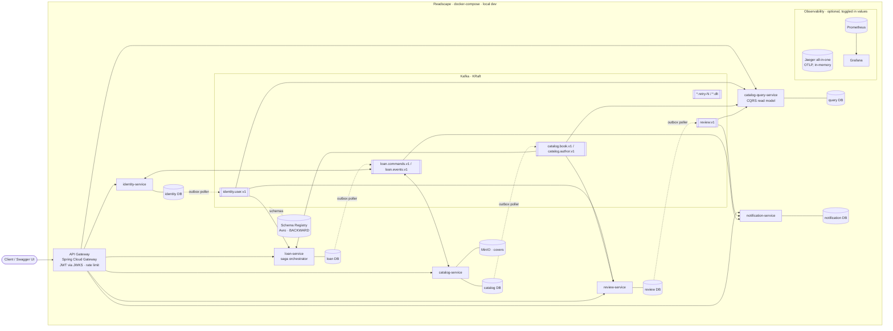
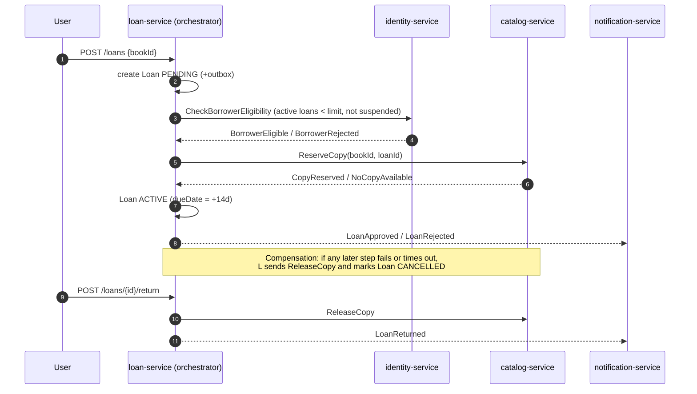

# Readscape (Book Management System v2) — Modernization Plan

Status: **draft for review** · Author: audit of `main` @ `2560d44` (last commit 2024-07-13) · Date: 2026-11-18

The goal of v2 is to turn the current Feign-heavy, Eureka-based demo into an **event-driven** system that shows
production-grade Kafka patterns (outbox, idempotent consumers, retry/DLQ, schema evolution, a saga, a CQRS read
model), real observability, and Testcontainers-backed tests. **Development runs locally on docker-compose**;
Kubernetes / Helm / minikube is deliberately deferred and re-evaluated once the application is done (§4.9).

---

## 1. Current state (v1 audit)

### 1.1 Services

| Service | Lang / build | Boot / Cloud | Persistence | Talks to | Responsibility |
|---|---|---|---|---|---|
| eureka-server | Java, Maven | 3.2.5 / 2023.0.1 | – | – | Service registry (:8761) |
| gateway | Java, Maven (WebFlux) | 3.2.5 / 2023.0.1 | – | all via `lb://` | Spring Cloud Gateway (:8888), JWT check + path/method role rules |
| auth-service | Java, Maven | 3.2.3 / 2023.0.1 | none (DataSource excluded) | account-service (Feign) | Register / login, issues HS256 JWT (60 min) |
| account-service | Java + Kotlin entity, Maven | 3.2.4 / 2023.0.1 | Postgres `accountDB` | review-service (Feign) | User accounts, roles; deletes user's reviews on delete |
| author-service | Kotlin, Gradle | 3.2.5 / 2023.0.1 | Postgres `authorDB` | book-service (Feign) | Author CRUD; deletes author's books on delete |
| book-service | Java + Kotlin entity, Maven | 3.2.2 / 2023.0.1 | Postgres `bookDB`, Redis cache, S3 images, Vault | author-service, review-service (Feign), S3 | Book CRUD, cover images, caching |
| review-service | Kotlin, Gradle | 3.2.4 / 2023.0.1 | Postgres `reviewDB` | book-, account-service (Feign), Kafka producer | Reviews + ratings; publishes review-created |
| notification-service | Java, Maven | 3.2.5 / 2023.0.1 | Postgres `notificationDB` | Kafka consumer | Stores a "Review created for book X" row |

All services: Java 17, `server.port: 0` (random), Eureka client, Micrometer Tracing (Brave) → Zipkin, sampling 1.0,
`ddl-auto: update` (no migrations). Five different Boot patch versions; two build tools; Kotlin entities compiled
inside Java Maven modules.

### 1.2 Communication

- **Sync**: Feign everywhere, mostly for *existence checks* ("does book X exist?") and *cascading deletes*
  (author → books, book → reviews, account → reviews). No timeouts, retries or circuit breakers configured.
- **Async**: exactly one flow.
  - Topic `review_service.review_created.0` — hard-coded string in `KafkaProducer.kt`; the configured
    `topicName` property is only copied into a header and never used. Topic is not declared; relies on
    broker auto-create.
  - Event shape: a Spring `GenericMessage` serialized with `JsonSerializer`, so the wire format is
    `{"payload": {id, accountId, bookId, rating, review, createdAt, updatedAt}, "headers": {...}}`.
    Key: none (`messageKey` is put in a *header*, not the record key). No event id, type, version or timestamp.
  - Consumer (notification-service) deserializes with `StringDeserializer` + `StringJsonMessageConverter`
    into a hand-copied `ReviewCreatedEvent` class. No error handler, no retry policy, no DLQ, no idempotency.

### 1.3 Auth flow

1. `POST /api/v1/auth/register` → auth-service bcrypt-hashes the password → Feign `POST /accounts` on
   account-service, which stores whatever `role` the request contained.
2. `POST /api/v1/auth/login` → auth-service fetches the account **including the password hash** over HTTP
   (`GET /accounts/username/{u}`), verifies with `DaoAuthenticationProvider`, issues an HS256 JWT with a `role` claim.
3. Gateway `AuthenticationFilter` validates the JWT with the same shared secret and applies a hand-rolled
   `path.contains(...)` + method table for "open" and "admin" endpoints. Downstream services do **no** auth at all.

### 1.4 Infrastructure

- `docker-compose.yml`: Redis, Zipkin, Zookeeper + Kafka (`bitnami/kafka:2-debian-10`), kafka-ui, swagger-ui,
  Vault 1.13. **No Postgres**, no service containers, no Dockerfiles. `./swagger` and `./vault/config` volumes
  referenced by compose do not exist in the repo.
- Redis: Spring Cache on book-service (`book_id`, `author_books`; the `books` cache is evicted but never filled).
- S3: AWS SDK v1 (`aws-java-sdk-s3` 1.12.470), region hard-coded `EU_NORTH_1`, images stored as `<bookId>.png`,
  credentials from Vault (`readscape/book-service`), Vault token from `${vault-token}`.
- README mentions a Config Server that does not exist.

### 1.5 Tests

Eight generated `contextLoads()` tests (13 lines each). They need live Postgres / Kafka / Eureka / Vault, so they
effectively never run. No unit, slice, integration or contract tests. No CI.

### 1.6 Does it build today?

Tried on JDK 21 with each module's own wrapper (`./mvnw -q -DskipTests package` / `./gradlew assemble`):

With `JAVA_HOME` on JDK 21 or 11 every Maven module fails (`release version 17 not supported` under the
machine's default JAVA_HOME; Gradle's Boot plugin needs JDK 17+). With **JDK 17** explicitly:

| Service | Result | Cause |
|---|---|---|
| eureka-server, gateway, notification-service | ✅ builds | – |
| author-service, review-service (Gradle) | ✅ builds | – |
| auth-service | ❌ | depends on `com.example:spring-security:0.0.1-SNAPSHOT`, which exists nowhere (a local-only artifact) |
| account-service | ❌ | Java code can't see the Kotlin entity `Account.kt` (Kotlin sources under `src/main/java`; javac runs before/without kotlinc) |
| book-service | ❌ | same as account-service (`Book.kt`, `BookGenres.kt`) |

**So 3 of 8 services do not compile from a clean checkout, and the system cannot run end-to-end today**
(auth + account + book are on the critical path). Even with builds fixed, running it needs a Postgres that
compose doesn't provide, a Vault with a manually seeded `readscape/book-service` secret, and real AWS S3
credentials. Nothing was started.

---

## 2. Problems found

### 2.1 Security (fix first — these are real vulnerabilities)

| # | Problem | Where |
|---|---|---|
| S1 | **Self-service privilege escalation**: `RegisterRequest.role` is passed straight to account-service, so anyone can register as `ADMIN`. | auth `RegisterRequest`, account `AccountService.createAccount` |
| S2 | **Password hash disclosure**: `GET /api/v1/accounts/**` is in the gateway's "open" list, and `/accounts/username/{u}` returns `AccountClientResponse` with the bcrypt hash. | gateway `RouteValidator`, account `AccountController` |
| S3 | Any authenticated user can create accounts (incl. admins) via `POST /api/v1/accounts`, update/delete any account, and delete *all* reviews of any book or account (`DELETE /reviews/book/{id}`). No ownership checks anywhere. | account, review controllers |
| S4 | JWT HS256 secret committed in `application.yml` of gateway and auth-service; same symmetric key shared. | yml |
| S5 | Plaintext passwords logged: `logger.info("Logging in user: {}", request)` (record `toString`), and account-service logs `AccountRequest`. | auth `AuthService`, account `AccountService` |
| S6 | Route matching uses `path.contains(...)` — brittle and easy to get wrong (e.g. any path containing `/api/v1/books` is treated as a books path). | gateway `RouteValidator` |
| S7 | Services trust the network: no auth on downstream services; reachable directly when not behind the gateway. | all |
| S8 | `management.endpoints.web.exposure.include: "*"` on book-service (env, heapdump, …). DB creds `postgres/postgres` in every yml. | book-service, all |

### 2.2 Consistency & messaging

- **Dual writes without an outbox**: review-service saves to Postgres then fires-and-forgets to Kafka outside the
  transaction; a crash or broker outage loses the event silently (error is only logged).
- **Distributed deletes over HTTP**: deleting an author/book/account calls other services first, then deletes
  locally — partial failure leaves orphans (`deleteBooksByAuthorId` also skips reviews and S3 images entirely).
- No record key → no per-aggregate ordering; no event id → no idempotency; no schema/version → no evolution story.
- No retry / DLQ / poison-pill handling; one bad message blocks the partition forever (default error handler
  logs and retries indefinitely on deserialization-adjacent failures, or skips — neither is observed).
- Topic name drift between config and code; topics not provisioned declaratively.

### 2.3 Coupling & data

- Separate logical databases but one Postgres instance with one superuser — services *could* read each other's DB.
- Read paths fan out synchronously (`GET /reviews/book/{id}` calls book-service first just to 404-check).
- Notification semantics are odd: the reviewer is notified about their own review.
- `ddl-auto: update` instead of migrations; `EnumType.ORDINAL` for roles (reordering the enum corrupts data).

### 2.4 Code quality / dead code

- `BookResponse.toDto` returns genres as `List.of(genres.toString())` → one string `"[Novel, Horror]"`.
- Cache bugs: `books` cache never populated; `author_books` never evicted on add/update/delete.
- `ReviewCreatedTopicProperties` field names don't match yml (`partitionsCount` vs `partitionCount`,
  `retentionMs` vs `retentionInMs`), the generic `ReviewCreatedKafkaConsumerConfiguration<T>` is unused-generic,
  `KafkaConstants.TOPIC` header is meaningless, `ReviewCreatedConsumerProperties` is unused.
- auth-service pins `spring-webmvc 6.1.3`, `tomcat-embed-core 10.1.18` and depends on a non-existent
  `com.example:spring-security:0.0.1-SNAPSHOT`.
- Copy-pasted `RetreiveMessageErrorDecoder` (typo) / `ExceptionMessage` / `NotFoundException` in 6 services.
- `.idea/` committed; README references Config Server, Vault screenshots and Swagger that are not in the repo.

### 2.5 Outdated / missing

- Spring Boot 3.2.x (OSS support ended 2024-11), Spring Cloud 2023.0, Java 17, Kotlin 1.9, jjwt 0.11,
  AWS SDK v1 (end-of-support), Kafka 2.x with ZooKeeper, Vault 1.13 image, `:latest` tags.
- Observability: Zipkin only, no metrics dashboards, no log correlation, trace not propagated over Kafka.
- Resilience: no timeouts / circuit breakers / bulkheads on Feign.
- No container images, no Kubernetes manifests, no health/readiness probes configured, no CI.

---

## 3. Keep / rewrite / drop per service

| v1 service | Decision | v2 shape |
|---|---|---|
| eureka-server | **Drop** | Docker Compose service names (DNS) do discovery now; Kubernetes Service DNS later. |
| gateway | **Rewrite** | Spring Cloud Gateway on Boot 4, OAuth2 resource server (JWKS), route rules by `pathMatchers`, in-memory rate limiter, OTel. Without Kubernetes there is no Ingress alternative, so the gateway stays. |
| auth-service + account-service | **Merge → `identity-service`** | Owns users, credentials, roles; issues **RS256** JWTs and serves `/.well-known/jwks.json`. Password hashes never leave the service. Publishes `identity.user.*` events. |
| author-service + book-service | **Rewrite → `catalog-service`** (merge decided) | Books, authors, copies/inventory, cover images (MinIO / S3 via AWS SDK v2). Publishes `catalog.book.*`, `catalog.author.*` via outbox. Participant in the borrow saga (reserve/release copy). |
| review-service | **Rewrite** | Reviews + ratings; validates book/user against **local projections** fed by events (no Feign). Publishes `review.*` via outbox. Reacts to `book.deleted` / `user.deleted`. |
| notification-service | **Rewrite** | Idempotent consumer of saga + review events; stores notifications, optional email via Mailpit in dev. Demonstrates retry topics + DLT. |
| *(new)* loan-service | **New** | Borrow saga orchestrator (see §4.3). |
| *(new)* catalog-query-service | **New** | CQRS read model: book view with avg rating, review count, availability, "readers also liked". |

---

## 4. Target architecture

### 4.1 Platform choices

- **Runtime**: **Java only** (decided), Java 25 LTS, Spring Boot 4.0.x, Spring Cloud 2025.1.x (verify latest
  patch at M0). No Kotlin anywhere; v1 Kotlin services are rewritten in Java.
- **Build**: one Gradle (Kotlin DSL build scripts, Java code) multi-project with convention plugins
  (`buildSrc`), shared `platform` BOM, `events` module holding Avro schemas + generated classes, `outbox` module,
  `common-web` for the error model (RFC 9457 `ProblemDetail`) — replaces 6 copies of `RetreiveMessageErrorDecoder`.
  Container images via `bootBuildImage`.
- **Discovery**: Docker Compose service names on fixed ports (`http://catalog-service:8080`), no Eureka, no
  client-side LB. The few remaining sync calls use `RestClient` / HTTP interface clients + Resilience4j timeouts;
  base URLs come from config, so the same code works on Kubernetes later.
- **Data**: Postgres per service — locally one Postgres container with **one database + one role per service**
  (created by an init script) and no cross-grants. Flyway migrations; `ddl-auto: validate`.
- **Secrets**: a git-ignored `.env` with a committed `.env.example`; no secrets in `application.yml`. No Vault.

### 4.2 Kafka conventions

- **Kafka**: single-node KRaft broker from the official `apache/kafka` image in docker-compose (no ZooKeeper).
  Topics declared as code by a one-shot `kafka-init` container (`kafka-topics.sh --create --if-not-exists`),
  auto-create disabled. kafka-ui (or AKHQ) for inspection.
- **Schema Registry**: Confluent `cp-schema-registry` (stores schemas in Kafka's `_schemas` topic, no extra DB).
  Apicurio is the alternative (open question 1).
- **Topics**: one per aggregate, `<context>.<aggregate>.v<major>` (e.g. `catalog.book.v1`), record **key =
  aggregate id** for per-entity ordering; event type in an Avro union / `eventType` header.
- **Envelope** (Avro): `eventId (UUID)`, `eventType`, `aggregateId`, `occurredAt`, `version`, `traceparent`,
  `payload`. Schemas in `events/src/main/avro`, compatibility **BACKWARD**, checked in CI against the registry.
- **Transactional outbox**: each producer writes the domain row and an `outbox` row in one DB transaction.
  Relay (decided, for RAM): an **in-process poller** in each producing service, from a shared `outbox` module
  (`SELECT … FOR UPDATE SKIP LOCKED LIMIT n`, publish with idempotent producer, mark sent; ordering kept per
  aggregate key). Debezium + Kafka Connect is a possible later swap (~1 GB extra) and gets an ADR either way.
- **Idempotent consumers**: `processed_event(event_id PK, consumer, processed_at)` inserted in the same
  transaction as the side effect; duplicates short-circuit. Producers use `enable.idempotence=true`.
- **Retry + DLQ**: Spring Kafka `@RetryableTopic` (non-blocking, exponential backoff, e.g. 3 attempts at
  1s/10s/60s) → `<topic>.dlt`; deserialization errors go straight to DLT via `ErrorHandlingDeserializer`.
  A small DLT inspector endpoint / Grafana panel shows DLT depth; a replay script re-publishes.

### 4.3 Saga — "borrow a book" (decided)

Orchestrated by **loan-service** (state machine persisted in `loan_saga` table, all commands/replies through
outbox → Kafka, so every step is retry-safe):

Timeouts are driven by a scheduled sweeper on `loan_saga.deadline`.

### 4.4 CQRS read model — catalog-query-service

- Consumes `catalog.book.v1`, `catalog.author.v1`, `review.v1`, `loan.events.v1`.
- Maintains `book_view(book_id, title, author_name, genres, avg_rating, review_count, available_copies, …)` and
  `co_rating(book_a, book_b, score)` for "readers who liked A also liked B" (top-N by co-occurrence of ≥4★
  ratings by the same user).
- Serves `GET /catalog/books?genre=&sort=rating`, `GET /catalog/books/{id}`, `GET /catalog/books/{id}/similar`.
- Rebuildable: a `reset` job rewinds the consumer group to offset 0 and replays (demonstrates event sourcing-lite).
- Storage: its own Postgres database (no Redis).

### 4.5 Observability

- **Tracing**: Micrometer Tracing → OpenTelemetry bridge → OTLP straight to Jaeger all-in-one (in-memory
  storage; no separate OTel Collector to save RAM — add one only if needed).
  Kafka observation enabled on `KafkaTemplate` and listener containers; outbox stores `traceparent` so a trace
  spans HTTP → DB → relay → consumer.
- **Metrics**: `/actuator/prometheus`; plain Prometheus server (pod-annotation scraping, no operator,
  no Alertmanager / node-exporter) + Grafana, dashboards as code: JVM/HTTP RED, Kafka consumer lag, DLT depth,
  outbox backlog, saga outcomes. Prometheus uses a static scrape config of the compose services.
- **Logs**: JSON structured logs (Boot's built-in structured logging) with `traceId`/`spanId`; optional Loki.

### 4.6 Testing

- Unit tests for domain logic (saga state machine, rating aggregation).
- `@SpringBootTest` + **Testcontainers** (`@ServiceConnection`): Postgres, Kafka, Schema Registry, MinIO.
  One reusable test-fixtures module.
- Messaging tests: outbox → Kafka round trip; duplicate delivery is idempotent; poison message lands in DLT;
  saga happy path + compensation.
- Schema compatibility check in CI; ArchUnit rule "no service depends on another service's module".
- Smoke test against `docker compose up` (k6 or a small script), also run in CI.

### 4.7 Local runtime

- One `docker-compose.yml` with profiles: `infra` (Postgres, Kafka, Schema Registry, MinIO, kafka-ui),
  `apps` (all services from `bootBuildImage` images), `obs` (Jaeger, Prometheus, Grafana).
- Day-to-day: `docker compose --profile infra up -d`, services run from the IDE / `./gradlew bootRun`.
- `make up` / `make down` / `make smoke` wrappers.
- GitHub Actions: build + test (Testcontainers) + schema compatibility check + compose smoke test.

### 4.8 Resource budget (local Docker)

Each service gets `mem_limit: 384m` with `-XX:MaxRAMPercentage=75`, virtual threads on.

| Component | Memory limit |
|---|---|
| 7 Java services (gateway, identity, catalog, review, loan, notification, catalog-query) | 7 × 384 Mi ≈ 2.7 GB |
| Kafka (1 KRaft node) | 768 Mi |
| Schema Registry | 384 Mi |
| Postgres (1 container, 6 DBs) | 256 Mi |
| MinIO | 128 Mi |
| Jaeger + Prometheus + Grafana (`obs` profile, optional) | ~700 Mi |
| **Total** | **≈ 4.2 GB** core, ≈ 4.9 GB with `obs` |

While developing, services usually run from the IDE, so Docker only holds the ~1.5 GB of infra. Redis is
dropped (decided): the CQRS read model replaces the book cache and the gateway rate limiter is in-memory.

### 4.8.1 M0 notes (as built)

- Versions: Gradle 9.9.1, Spring Boot 4.0.9, Spring Cloud 2025.1.4, Testcontainers 2.0.5, Kafka 4.3.2,
  Confluent Schema Registry 8.3.3, Postgres 17. Boot 4 starter names: `spring-boot-starter-webmvc`,
  `spring-boot-starter-flyway`, `spring-boot-starter-kafka`; gateway is `spring-cloud-starter-gateway-server-webflux`.
- Postgres is on host port **5433** (5432 is taken locally); services default to `DB_PORT=5433`.
- Measured infra footprint: ~1.26 GiB (infra) + ~0.27 GiB (obs).
- MinIO no longer publishes versioned Docker Hub tags; images are pinned by digest. Revisit (e.g. an
  S3-compatible alternative) if that becomes a problem.

### 4.9 Later: Kubernetes (deferred, to be evaluated)

Not part of the current milestones. If picked up after M6: per-service Helm charts on a shared library chart,
an infra chart, probes, deployment to minikube (via its own kubeconfig, never the default one) and observation
with KYMO. The code is prepared for it by config-driven URLs, actuator health groups and container images.

---

## 5. Milestones

Each milestone is a PR (or a short series) that leaves `main` green and demoable.

| # | Milestone | Scope | Done when |
|---|---|---|---|
| M0 | **Foundation** | `v2` branch that replaces `main` once M1 is done (v1 not kept, decided); Gradle multi-project; Java 25 / Boot 4 / Cloud 2025.1; `common-web`, `platform`, `test-fixtures` modules; Flyway; skeletons (no domain logic yet) for gateway, identity, catalog, review, notification; docker-compose `infra` profile (Postgres, Kafka KRaft, Schema Registry, MinIO); Eureka removed; CI. | `./gradlew build` green in CI; every skeleton starts against compose and reports UP on `/actuator/health`; each service has ≥1 Testcontainers test. |
| M1 | **Identity, CRUD & security** | Port catalog (books+authors) and review CRUD to Java (fix genres/cache bugs on the way); merge auth+account → identity-service; RS256 + JWKS; gateway + services as OAuth2 resource servers; ownership checks; drop role from register (admin seeded via migration); remove secret/password logging; actuator locked down; `apps` compose profile. | Tests prove S1–S8 fixed (can't self-register admin, no hash in any response, user can't delete others' reviews); login + CRUD smoke test passes through the gateway on `docker compose up`. |
| M2 | **Event backbone** | `events` module with Avro schemas + Schema Registry; outbox in catalog & review; poller relay; idempotent consumers; retry topics + DLT; replace cascade-delete Feign calls and existence checks with events/projections; notification rewritten. | Stop Kafka mid-request → no event lost after restart; duplicate replay causes no duplicate rows; poison message ends in DLT; no Feign left except gateway→services. |
| M3 | **Observability** | `obs` compose profile: Jaeger (OTLP), Prometheus + Grafana, dashboards as code, structured logs. | One trace shows gateway → catalog → outbox → Kafka → review/notification; dashboards show consumer lag & DLT depth. |
| M4 | **CQRS read model** | catalog-query-service with book view, ratings, similar-books; replay/rebuild job. | Read API returns rating stats consistent with review-service within seconds; rebuild from offset 0 reproduces identical view. |
| M5 | **Borrow saga** | loan-service orchestrator; eligibility in identity; copy reservation in catalog; compensation + timeouts. | Tests for happy path, no-copy, ineligible user, and timeout-compensation; concurrent borrows never over-reserve copies. |
| M6 | **Hardening & story** | Resilience4j on remaining sync calls; k6 load test; failure drills (stop containers mid-saga, watch in Grafana/Jaeger); README rewrite, architecture diagram, ADRs. | README demo script works end-to-end on a clean machine; ADRs for each decision in §6. |
| later | **Kubernetes** (optional) | See §4.9 — decided after M6. | – |

---

## 6. Decisions and open questions

### Decided (2026-11-19)

- **Language**: all services in Java.
- **Service boundaries**: as proposed in §3 (identity, catalog, review, loan, notification, catalog-query,
  gateway); CV wording is updated at the end.
- **Messaging**: Kafka for all async communication; outbox relay is the in-process poller (RAM).
- **v1**: not preserved; v2 replaces it on `main`.
- **Footprint**: keep it small (§4.8): Redis dropped, no Kafka Connect.
- **Gateway**: Spring Cloud Gateway, rewritten.
- **Saga**: borrow/return a book (§4.3), orchestrated by loan-service.
- **Frontend**: none for now — API only, with springdoc OpenAPI per service aggregated into one Swagger UI at the gateway.
- **Name**: **Readscape**. Group/packages `com.readscape.*`, compose project `readscape`.
- **Runtime**: develop on docker-compose first; Kubernetes / Helm / minikube deferred (§4.9).

### Still open

1. **Schema Registry**: Confluent (recommended, assumed by default) or Apicurio?
2. **Images**: MinIO container instead of real AWS S3 (recommended, assumed by default)?
